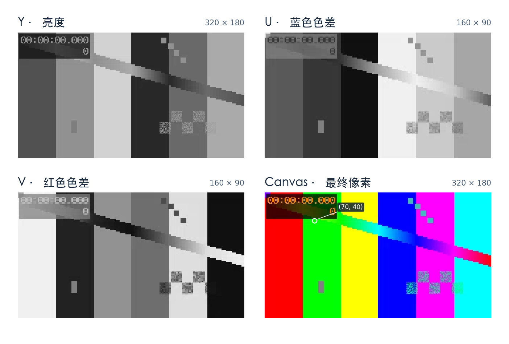

# 某Player 1.8.11 的 EV2、Canvas 渲染与音频播放
(ev1已有标准解法出现，实测为混淆，故本文不再阐述)
<br>
这版播放器把工作分给了三个地方。**EV2 插件 WASM 把文件字节还原为 FLV，播放 WASM 把 FLV 中的 H.264 和 AAC 解成画面与声音，JS 把画面交给 WebGL、把声音交给 Web Audio。** 因此，要看压缩视频数据、解码后的像素、最终画布上的颜色，需要在三个不同位置观察。

下文对应提供的 `bplayer.js`、`ffplayer.js`、`combine-flv-h264-aac.wasm`、以 `04bd74e2` 开头的 Worker，以及播放器引用的 1.8.11 版 EV2 插件。实测使用随附的合成 EV2。真实平台 EV2 文件的兼容性仍待验证。

**按问题跳读**　[文件里的第一对音视频包](#flv-tags) · [同一帧的四张实测图](#real-frame) · [手算一个像素](#pixel) · [变速和音频时钟](#audio-clock) · [断点与复验](#inspect)

## 1. 先跑 Java 工具

把 JAR 和样例放在同一目录，在该目录运行。需要 Java 17 或以上版本。两个子命令都离线运行，只使用 JDK 标准库。


第一条应输出 `https://example.com/a.ev2?t=1`。第二条应生成 **163682 字节**的 FLV。可以将第一条的整个参数替换为你的 `enc_url`。要处理自己的 EV2，把第二条的输入和输出路径一起替换，输出目录须存在，输出文件名须尚未使用。

| 样例 | 可复验的结果 |
|---|---|
| [example.ev2](example.ev2) | 163794 字节，包含三秒测试图和 440 Hz 测试音 |
| 解密后的 `restored.flv` | SHA-256 为 `d5843e77a607fc8fe3d9b15f53d112c9a38ef188605243de4891526e9964d317` |
| 视频轨 | H.264，320 × 180，10 帧/秒，30 帧 |
| 音频轨 | AAC，48000 Hz，双声道，142 个解码音频帧 |

在 macOS 可用以下命令核对结果。第二条需要已安装 FFmpeg 工具。

```sh
shasum -a 256 restored.flv
ffprobe -v error -count_frames -show_entries stream=codec_name,width,height,sample_rate,channels,nb_read_frames -of json restored.flv
```

如果想改源码，JDK 可直接运行 `java BjCloudTool.java ev2 example.ev2 another.flv`。在已有 Java 工程里也可以直接调用 `BjCloudTool.decodeUrl(String)` 和 `BjCloudTool.decryptEv2(Path, Path)`。后者返回写出的字节数。[Java 源码](BjCloudTool.java) · [可执行 JAR](BjCloudTool.jar)

## 2. 从请求地址到画面与声音

```text
enc_url ── bplayer.js 解出地址 ──► FetchLoader 按 HTTP Range 取文件
                                      │
                    EV2 的 112 字节尾部 ──► 插件 init，建立循环掩码
                                      │
                       EV2 正文分块 + 文件偏移
                                      ▼
                     ev2-decrypt.wasm / decrypt
                                      │ 已还原的 FLV 字节
                                      ▼
                 combine-flv-h264-aac.wasm / 流缓冲和解封装
                            ┌─────────┴─────────┐
                        H.264 视频包          AAC 音频包
                            ▼                   ▼
                        decode_video        decode_audio
                            ▼                   ▼
                        Y、U、V 平面        各声道的 PCM 样本
                            ▼                   ▼
                      JS 视频帧队列         JS 音频变速 Worker
                            ▼                   ▼
                      三张 WebGL 纹理       Web Audio 时间线
                            ▼                   ▼
                 着色器换算 RGB、画 Canvas    声道、增益、音频出口
```

`bplayer.js` 创建 `<canvas id="bplayer-ffplayer">`，以该元素构造 `FFPlayer.Player`。这里设置了 `useCombine: true`、`enableWorker: false`、`enablePthreads: false`，并把 `ev1`、`ev2` 映射到 `flv`。在这套配置里，解封装、视频解码和音频解码包装器使用同一个播放 WASM 实例。EV2 插件有自己的实例和线性内存。浏览器对 WebGL 和音频 Worker 的支持仍分别生效。

播放模块里可以找到 `libavformat/flvdec.c`、`libavcodec/h264dec.c`、`libavcodec/aacsbr.c` 相关路径和 `Lavc58.91.100` 标识。它把 FFmpeg 组件封装在 `open_file`、`demux`、`decode_video`、`decode_audio` 等自定义接口后面。页面使用的 `FFPlayer.Player` 是 JS 类。播放器还包含 WebCodecs、WebGPU、MSE 等代码，以下调用链对应本次配置和实测的 H.264/AAC 样例。

### 2.1 页面配置与生效配置

从 `new FFPlayer.Player(canvas, options)` 跟进构造器，要经过一次 `checkOptions()`。它会根据点播、直播和浏览器能力改写若干选项。样例的关键值如下。

| 选项或对象 | BPlayer 提供的值 | FFPlayer 在这次点播中采用的行为 |
|---|---|---|
| `useCombine` | `true` | 在 context 包装器上实例化一次 combine，其他包装器通过 `installInstance` 取得同一实例。多个包装器名称不代表多次下载同一段视频。 |
| 解码与绘制 | 传入 `useWebCodec: false`、`enableHardwareAcceleration: true` | 分轨判断读取 `useVideoWebCodec`、`useAudioWebCodec`。本次实测由 WASM 解码并回传 YUV/PCM；WebGL 接管后续画面合成。单看硬件加速选项无法判断由谁解 H.264。 |
| `bufferSize` / `bufferWin` | 8388608 / 102400 字节 | 点播将两项分别限制在至少 2097152 / 1048576 字节。这里实际为 8 MiB / 1 MiB，两项分别参与流缓冲及解封装窗口配置。 |
| `enableMeter` / `enableGain` | 电平计设为 `true`，增益沿用默认值 | `isLive: false` 会关闭电平计。音量调节仍使用增益节点。 |
| Canvas | `preserveDrawingBuffer: true` | JS 取得 WebGL 上下文。这里可在绘制后读回颜色；视频解码结果仍保存在各个 YUV 平面里。 |

线性内存指针是相对于某个 `WebAssembly.Memory.buffer` 的字节偏移。比如解密插件返回的 `ptr=4096` 与播放模块内的 `4096` 指向各自内存中的位置。两个实例间通过 JS 的字节块交接；播放实例内部的解封装、音频解码和视频解码可以共享同一块线性内存。

## 3. 喂给两个 WASM 的分别是什么

| 边界 | 调用和数据 | 内存由谁持有 |
|---|---|---|
| JS → EV2 初始化 | `init(sizeLow32, sizeHigh32, trailerPtr, trailerLength)`。前两个数共同表示含尾部的总文件长度，尾部正常为 112 字节。 | JS 在插件内存分配并复制尾部，初始化后释放临时区。 |
| JS → EV2 每一块 | `decrypt(ptr, byteLength, absoluteOffset)`。偏移是块首字节在原文件中的位置，单位为字节。 | 插件原地异或。JS 复制还原后的块，再释放插件里的临时区。 |
| JS → 播放模块 | `onDataArrival` 把还原后的块交给 `processPipe.appendData`。流缓冲保存当前的 `Uint8Array`，按容量切片，调用 `append_buffer(0, n)`。 | 播放 WASM 回调 `js_buffer_cpy(dst, srcOffset, count)`，JS 从当前切片拷贝指定区间到播放 WASM 的 `dst`。这里的首参 0 和 EV2 的文件偏移含义不同。 |
| 播放模块 → JS | 先报告编码参数，随后按帧回调。视频可给出指针区间，音频可先请求 JS 分配数组再复制样本。 | 帧类型决定 JS 持有独立副本，还是稍后通过 WASM 内存视图取数据。 |

HTTP 块可以刚好切开一个 FLV tag。流缓冲先将分段输入接起来，点播路径在达到探测条件或输入结束后调用 `open_file`。识别到轨道后分别调用 `open_video_codec`、`open_audio_codec`。FLV 容器的 tag 区分音频、视频和元数据，解封装阶段把压缩数据送到相应的包队列。H.264 和 AAC 解码器随后从各自队列取包。网络块、压缩包、解码帧各有自己的边界。

`demuxTask`、`videoDecodeTask`、`audioDecodeTask` 分开调度。JS 通过 `canDecodeVideo`、`canDecodeAudio` 检查下游队列容量。BPlayer 在此处配置了 8 MiB 流缓冲和 10 帧的队列参数；解码和绘制可以发生在不同的时间。

<a id="flv-tags"></a>

### 3.1 按文件偏移拆开第一对音视频包

下面的偏移从 `restored.flv` 开头按 **0** 计数。EV2 正文逐字节异或，所以同一字节在加密文件和还原文件里的位置完全相同。文件头的 13 个字节是 `46 4c 56 01 05 00 00 00 09 00 00 00 00`。前三字节是 FLV，版本为 1，标志 `05` 表示有音频和视频，数据偏移为 9。紧随文件头的四字节 `PreviousTagSize0` 为 0，首个 tag 从偏移 13 开始。

每个 tag 有 11 字节头、`DataSize` 字节载荷和 4 字节 `PreviousTagSize`。最后这个值等于该 tag 的 `11 + DataSize`。遍历时用 `next = offset + 11 + DataSize + 4`。头里的三字节长度和三字节时间戳低位都按大端读取，时间戳另有一个高字节。

| tag 起点 | 类型 | 载荷字节 | 时间戳（ms） | 样例内容 |
|---:|---|---:|---:|---|
| 13 | 脚本数据 `0x12` | 292 | 0 | AMF 的 `onMetaData`。 |
| 320 | 视频 `0x09` | 43 | 0 | `17 00` 引出 AVC 配置。配置记录给出 4 字节 NAL 长度字段、23 字节 SPS 和 4 字节 PPS。解码器用它们解释后续视频包。 |
| 378 | 音频 `0x08` | 7 | 0 | `af 00` 引出 AAC 的 AudioSpecificConfig。`11 90` 开头的配置给出 AAC-LC、48000 Hz、双声道。 |
| 400 | 音频 `0x08` | 228 | 0 | `af 01` 后面是 226 字节的 AAC 压缩数据；这是第一段解出 PCM 的包。 |
| 643 | 视频 `0x09` | 7537 | 21 | `17 01` 表示关键帧的 AVC NAL 单元。此包对应图中的第一帧。 |
| 8195 | 音频 `0x08` | 292 | 21 | 第二个 AAC 数据包。再往后还有 42、64、85、106 ms 的音频包。 |
| 9534 | 视频 `0x09` | 3237 | 121 | `27 01`，后续预测帧。两视频帧相差 100 ms，与 10 帧/秒吻合。 |

具体拆开偏移 643 的视频 tag 就能解释 `ffprobe` 的包大小。载荷的前 5 字节是 `17 01 00 00 00`。最后三个零是有符号的 AVC 合成时间差，本帧 `PTS = DTS + 0 = 21 ms`。一般文件里合成时间差可以非零，特别是 H.264 对显示顺序进行重排时。余下的 7532 字节由两段组成：

```text
文件偏移 659   00 00 02 52   第一段长 594，NAL 类型 6，SEI 补充信息
文件偏移 1257  00 00 1b 12   第二段长 6930，NAL 类型 5，IDR 图像
4 + 594 + 4 + 6930 = 7532
643 + 11 + 7537 + 4 = 8195    下一 tag 的实际起点
```

同一个画面在文件里是 **7532 字节的视频包**，解码后是 **86400 字节 YUV**，读回 RGBA 则是 **230400 字节**。这三个长度分别对应压缩表示、解码表示和显示表示。音频也能这样追踪：偏移 400 处的 226 字节 AAC，在这次实测中解出 8192 字节双声道 PCM。

### 3.2 为什么可以边下载边播放

`FetchLoader` 把一次读取的网络块先交给 `bufferPipe`。解密后，JS 可把同一块交给 AMF 解析器读取元数据，同时交给播放 WASM。比如网络在文件偏移 4096 处断块，这个位置正位于第一张 IDR 图像中间。新块继续按自己的文件偏移解密，流缓冲衔接字节，解封装器才能取齐包头声明的载荷。

播放器还从三个位置限制提前积压的数据。点播入口的 `canFireData(n)` 在当前配置下要求播放 WASM 剩余缓冲减去 **512000 字节**后仍大于 `n`。视频的 `canPushFrame()` 检查视频帧队列长度是否低于上限；音频检查自己的排程或待播队列。于是网络块、视频帧和音频帧分别按字节容量或队列容量流动。首个解码回调到达、浏览器开始画第一帧、第一段声音开始播放，是三个可分别观察的时刻。

## 4. 一帧 H.264 怎样画到 Canvas

### 4.1 WASM 先告诉 JS 怎么解释内存

`js_receive_video_codec(width, height, pixFmt, codecId, profile, level, linesize)` 提供整条视频轨的参数。`width` 是可见宽度，`linesize` 是一行在内存里的跨度。对于这里的 8 位 Y 平面，一行可以因为对齐而比可见宽度多占几个字节。

随后，样例每解出一帧，就调用一次以下接口。指针和长度的单位都是字节。最后两个数合成呈现时间戳 PTS，播放器在这条路径用毫秒比较时间。

```text
js_receive_yuv(yPtr, yBytes, uPtr, uBytes, vPtr, vBytes, ptsLow, ptsHigh)
```

| 第一帧实测 | Y 平面 | U 平面 | V 平面 |
|---|---:|---:|---:|
| 纹理尺寸 | 320 × 180 | 160 × 90 | 160 × 90 |
| WASM 回调中的字节数 | 57600 | 14400 | 14400 |
| 含义 | 每个像素的亮度 | 蓝色色差 | 红色色差 |

这帧是 8 位 YUV420P，PTS 为 **21 ms**。每个 2 × 2 的亮度区域共用一组 U、V 样本，因此一帧占 86400 字节。三个平面各有独立指针，读取时应使用回调给出的地址和长度。收到新的 `js_receive_video_codec` 参数后，渲染器会按新的分辨率和像素格式调整纹理尺寸。

### 4.2 JS 把平面排队，绘制时才读取

在本次使用的 `YUV` 帧路径，`js_receive_yuv` 只建立三个区间和一个时间戳。播放器通过 `videoRender.pushFrame` 入队。轮到该帧显示时，`renderFrame` 进入 WebGL 渲染器，后者用 `processPipe.uint8Subarray(start, end)` 取得线性内存视图。`subarray` 共享底层字节，上传纹理时 WebGL 消费视图中的数据。正常播放的 `playFrame()` 先取出帧，完成绘制或丢弃后再经 `onFramePop` 通知 WASM；加载时首帧预览另有一条直接绘制分支。长期保存某一帧需要在其有效期内复制平面。

源码还支持 `UINT_8_ARRAY` 帧。这条分支收到一个连续数组，绘制器根据像素格式计算 Y、U、V 的切分位置。本次原版播放 WASM 对样例的 30 帧视频均调用了 `js_receive_yuv`。

### 4.3 WebGL 上传三张纹理，片元着色器生成颜色

初始化时，JS 对 Canvas 调用 `getContext("webgl")`，绑定顶点缓冲、顶点着色器和片元着色器。Y、U、V 纹理分别绑定纹理单元 0、1、2。对于 YUV420P，源码用 `linesize × height` 设置 Y 纹理，用 `(linesize >> 1) × (height >> 1)` 设置 U/V。布局代码根据可见宽度裁掉行尾填充，并按 Canvas 比例排列四个顶点。

以下示意把纹理单元绑定写在循环中，便于看清三张纹理的关系。原版在初始化时关联采样器与纹理单元，每帧由三个纹理对象分别执行 `fill`。

```js
for (const plane of [Y, U, V]) {
  const bytes = heapU8.subarray(plane.ptr, plane.ptr + plane.byteLength);
  gl.activeTexture(gl.TEXTURE0 + plane.unit);
  gl.bindTexture(gl.TEXTURE_2D, plane.texture);
  gl.pixelStorei(gl.UNPACK_ALIGNMENT, plane.alignment);
  gl.texImage2D(gl.TEXTURE_2D, 0, gl.LUMINANCE, plane.width, plane.height,
                0, gl.LUMINANCE, gl.UNSIGNED_BYTE, bytes);
}
gl.clear(gl.COLOR_BUFFER_BIT | gl.DEPTH_BUFFER_BIT);
gl.drawArrays(gl.TRIANGLE_STRIP, 0, 4);
```

`UNPACK_ALIGNMENT` 根据纹理宽度取 8、4、2 或 1，让 WebGL 正确跨到下一行。着色器在同一画面坐标采样三张纹理。U/V 的分辨率较低，线性纹理过滤负责在相邻色度样本间插值。顶点着色器处理几何位置和旋转，片元着色器执行源码中名为 `YUV2RGB` 的矩阵乘法。令 `y,u,v` 为纹理采样得到的 0–1 数值，三个输出分量近似如下。

```text
R = 1.164383 × y                  + 1.596027 × v − 0.870785
G = 1.164383 × y − 0.391762 × u − 0.812969 × v + 0.529594
B = 1.164383 × y + 2.017234 × u                 − 1.081391
```

`drawArrays(TRIANGLE_STRIP, 0, 4)` 用四个顶点组成两个三角形，覆盖显示视频的矩形。浏览器在 Canvas 绘图缓冲中得到最终颜色。配置中的 `preserveDrawingBuffer: true` 使绘制结果可以保留供后续读取。如果启用了跑马灯，还会用另一张纹理叠画文字。Java 解出的 FLV 处在上述着色和叠画之前。[WebGL 1.0 规范](https://registry.khronos.org/webgl/specs/latest/1.0/)

**浏览器实测。** 将随附样例交给原版 EV2 插件和原版 FFPlayer，在无界面 Chromium 里记录到了三次纹理上传，尺寸、字节数与上表完全一致。对第一次视频绘制执行 `readPixels`，320 × 180 的画面中读到了 7176 种 RGBA 值。这个测试覆盖了从 EV2 分块到 Canvas 像素的完整路径，使用的是浏览器的软件图形后端。

<a id="real-frame"></a>

### 4.4 同一帧的三张输入纹理和一张输出画布



左上、右上和左下取自**同一次绘制**的三次 `texImage2D` 调用，按各自字节值显示为灰度。U/V 放大到同样的版面宽度，原始采样点每行仍只有 160 个。右下来自 `drawArrays` 执行后的 `readPixels`，已将读回数据翻转成常见的左上原点方向。图中的白圈和坐标是说明用标注。

前三幅里都能看到测试图左上角的时间码，说明这块文字已经编码在样例画面里。若是播放器用 `marqueeProgram.render()` 额外叠画的文字，它会在视频纹理上传之后出现。比较这两个观察位置，就能判断特定文字来自媒体还是当前页面的叠加层。

<a id="pixel"></a>

### 4.5 手算图中 (70, 40) 的颜色

坐标取可见图像左上角为原点。这次视频宽度和行跨度都是 320，Canvas 绘图缓冲也是 320 × 180，没有旋转或缩放。

1. **Y 平面。** 字节下标为 `40 × 320 + 70 = 12870`，实际值为 **144**。对于带行尾填充的画面，乘数要用 `linesize`。
2. **U/V 平面。** 像素中心对应的色度纹理位置为 `((70 + 0.5)/2 − 0.5, (40 + 0.5)/2 − 0.5) = (34.75, 19.75)`。四个邻点的 U 值按行排列为 `[55, 55; 54, 54]`，V 为 `[33, 33; 34, 34]`。按左右、上下距离做双线性插值后，得到 **U = 54.25，V = 33.75**。数值带小数是纹理过滤的结果，原文件中的平面仍是整数字节。
3. **片元着色器。** 将 `(144, 54.25, 33.75) / 255` 代入第 4.3 节矩阵，换算回 8 位 RGB 约为 `(−0.51, 254.03, 1.35)`。按通道限幅、取整，得到 `(0, 254, 1)`。
4. **浏览器对照。** WebGL 的 `readPixels` 以左下角为原点，所以读取 `(70, 180 − 1 − 40) = (70, 139)`。实测为 **RGBA (0, 254, 1, 255)**，最后的 255 表示不透明。一个源像素到画布颜色的链路至此可以逐项复算。

### 4.6 换分辨率、缩放或旋转时，哪一层改变

| 情形 | 所在环节 | 对画面的影响 |
|---|---|---|
| 行跨度大于可见宽度 | `setCodec` 与 `layout` | 例如可见宽 854、跨度 864，Y 纹理按 864 列上传，右边界的纹理坐标为 `854 / 864 ≈ 0.98843`，避开行尾填充。这是布局示例。 |
| 切换像素格式 | `setCodec` | 420 的色度宽高各减半；422 只把宽度减半；444 的色度尺寸与 Y 相同。平面长度和行跨度随格式重新解释。 |
| Canvas 显示面积改变 | `viewport` 与顶点缓冲 | JS 按设备像素比设置绘图缓冲并调整 `gl.viewport`。FIT 模式下保持视频比例，例如 320 × 180 放到 320 × 240、像素比为 1 的画布中，上下各留 30 像素。 |
| 旋转 | 顶点着色器的 `rotateMatrix` | 改变矩形顶点位置；90°、270°布局还会交换参与计算的视口宽高。解码器仍输出同一帧的三张平面。 |

`UNPACK_ALIGNMENT` 控制 WebGL 读取每行源字节的对齐方式，`linesize` 表示解码平面的实际行跨度，`devicePixelRatio` 决定屏幕绘图缓冲的像素密度。排查图像倾斜、右侧出现填充或读错画布坐标时，分别核对这三个量。

## 5. 一段 AAC 怎样交给扬声器

### 5.1 AAC 压缩包解成左右声道 PCM

`decode_audio` 解出采样值，`js_receive_audio_codec` 报告声道数、采样率、采样格式和编码标识。样例报告双声道、48000 Hz、`sampleFmt=8`，对应平面排列的 32 位浮点样本。对样例的每个解码音频帧，实际调用顺序如下。

| 步骤 | 样例中观察到的参数 | JS 做的事 |
|---|---|---|
| 1. `js_frame_malloc` | `(AUDIO, 8192)` | 建立一个 8192 字节的 JS 数组。 |
| 2. `js_frame_cpy`，两次 | 每次 4096 字节，目标偏移分别为 0 和 4096 | 分别从 WASM 拷贝一个声道。数组前半是 1024 个左声道 float，后半是 1024 个右声道 float。 |
| 3. `js_receive_frame` | 首帧为 `(AUDIO, 0, 8192, 0, 0)` | 数据指针为 0 表示沿用刚填好的 `audioFrame`；最后两项给出 PTS。 |
| 4. `audioRender.pushFrame` | 数据数组和 PTS | 将字节解释为 `Float32Array`，按声道切开，交给变速处理。 |

单个声道的帧时长为 `1024 / 48000 ≈ 21.33 ms`。两路声道同步播放，时长仍为 21.33 ms。JS 中另有 `js_receive_pcm(leftPtr, leftBytes, rightPtr, rightBytes, ptsLow, ptsHigh)` 分支，它把字节位置右移两位得到 float 下标。**在本次原版 WASM 测试中，142 个音频帧都走了上表的复制路径，`js_receive_pcm` 调用次数为 0。**

### 5.2 UUID 文件是音频变速 Worker

`ffplayer.js` 把打包模块 47 及其依赖写入 JavaScript Blob，生成对象 URL 并传给 `new Worker(...)`。`04bd74e2-254a-4a1d-aeae-f87986c06e0e` 正是这个 Worker 的入口。这里的选择条件是 `B.worker && !this.options.enableWorker`。所以主解码流程在主线程运行时，音频变速仍可单独使用 Worker。

| 方向 | 消息 | 载荷与用途 |
|---|---|---|
| 主线程 → Worker | `init` | 声道数、采样率、每帧样本数、缓冲容量、播放速率。 |
| 主线程 → Worker | `addBuffer` | `bufferL`、`bufferR`、`pts`。双声道发送两块 PCM，单声道的右侧为 `null`。发送前主线程复制所需声道数据，通过 transfer list 转移独立缓冲的所有权。 |
| Worker → 主线程 | `onFrameReceive` | 处理后的左右声道缓冲、`pts`、`remainingSize`、`bufferFrameSize`、`seq`。重置后用 `seq` 过滤旧结果。 |
| 主线程 → Worker | `call` / `reset` | 调整播放速率、冲刷末尾样本，或在重新定位时重置处理状态。 |

正常 1 倍速时，处理器从声道缓冲按帧取样。变速时可以看到 `olaL`、`olaR` 和 `setAlpha(1 / rate)`，左右声道分别做重叠相加处理，再拼出输出帧。Worker 的 `postMessage` 把这些数据交给创建它的线程。这个 UUID 文件里没有建立 WebSocket 或调用网络发送接口。[Web Worker 消息与线程模型](https://html.spec.whatwg.org/multipage/workers.html)

### 5.3 Web Audio 排程

主线程收到 Worker 输出后，调用 `audioContext.createBuffer(channels, frameLength, sampleRate)`，通过 `copyToChannel` 填入左右声道。接着创建 `AudioBufferSourceNode`，设置 `source.buffer`，本次点播的 `checkOptions()` 关闭电平计，默认启用增益，所以实际连接顺序为 `AudioBufferSourceNode → GainNode → audioContext.destination`。源码里的电平计节点是其他配置可选的分支。

播放器用 `source.start(startTime)` 把音频块排到 Web Audio 时间线上，然后执行 `startTime += buffer.duration`。相邻块由音频时钟衔接。每个源的 `onended` 更新当前音频 PTS、释放队列位置。源码中的文件 PTS 用毫秒，`AudioContext.currentTime`、`startTime`、`duration` 用秒。[Web Audio 规范](https://www.w3.org/TR/webaudio-1.0/)

浏览器实测读到了每声道 1024 个样本、48000 Hz、双声道的 `AudioBuffer`，左声道存在非零信号。验证覆盖到 Worker 传递和浏览器音频源排程；使用无声输出，没有进行扬声器听测。

<a id="audio-clock"></a>

### 5.4 跟踪前六段 PCM 的两套时间

这次在浏览器里同时记录了主线程发出的 `addBuffer.pts`、Worker 回传的 `onFrameReceive.pts`，以及 `AudioBufferSourceNode.start(when)` 的参数。使用随附样例，播放速率为 1。

| 音频块 | 发给 Worker 的 PTS（ms） | Worker 返回的 PTS（ms） | 距首个音频源的排程时间（ms） |
|---:|---:|---:|---:|
| 1 | 0 | 0 | 0.000 |
| 2 | 21 | 21 | 21.333 |
| 3 | 42 | 42 | 42.667 |
| 4 | 64 | 64 | 64.000 |
| 5 | 85 | 85 | 85.333 |
| 6 | 106 | 106 | 106.667 |

每次 Worker 回传的左声道缓冲都是 4096 字节。前六个媒体 PTS 以整数毫秒表示，而 Web Audio 按每块的 `1024 / 48000` 秒累加。本次首块的 `when` 约为 0.110295 秒，以本次创建的 AudioContext 为原点；下一次启动时这个绝对值可以变。核对连续播放应看两次 `start` 的差值。比如在视频首帧的 PTS 21 ms 处，第二个 AAC 包已有对应时间戳；音频设备排程上的第二块恰好在首块之后 21.333 ms 开始。

### 5.5 2 倍速为何还能保持音高

Worker 的 `setPlayRate(rate)` 向左右声道处理器传入 `alpha = 1 / rate`。1 倍速有按帧取样的直接分支。变速分支执行 `STFT → pvStep → ISTFT → overlapAndSlide`，即给一窗样本加窗、做快速傅里叶变换、根据分析与合成步长调整频率分量的相位、逆变换并重叠相加。这是相位声码器的时间伸缩方法。

用本例每声道 1024 个样本的窗长举例。2 倍速给出 `alpha=0.5`，源码取重叠因子 2，分析步长 `ha=512`，合成步长 `hs=256`。输入窗口每次往前走 512 个样本，合成时间轴向前走 256 个样本，因此声音时长约减半。处理器把输出暂存在中间缓冲，凑齐一帧再发回。Web Audio 仍按 48000 Hz 播这些新样本。

单独给**原版 UUID Worker**喂入 144 帧单声道、48000 Hz 的 440 Hz 正弦波，并在末尾调用 `flush`，得到以下结果。中段频率按正向过零间距估计。这个输入是在 Worker 层生成的，和三秒 EV2 容器测试分开。

| 倍率 | 输入样本 | 输出样本 | 输出时长 | 中段测得频率 |
|---:|---:|---:|---:|---:|
| 1× | 147456 | 147456 | 3.072 s | 440.00 Hz |
| 2× | 147456 | 73728 | 1.536 s | 440.00 Hz |
| 0.5× | 147456 | 293560 | 6.116 s | 440.00 Hz |

慢速行是该 Worker 对这段有限长度输入的实际输出，理论时长是 6.144 秒。读这张表时应把末尾冲刷和步长舍入算在内；持续段的音高与整段的精确样本数是两项独立测量。

## 6. 音视频怎样同步，拖动进度条时发生什么

- **主时钟。** `getMasterPts()` 优先使用有可用音频队列的音频时间。没有可用音频时钟时，通过“起始 PTS + 已过时间 × 播放倍率”估计当前位置。
- **视频画哪一帧。** `syncPlay()` 比较下一帧的 PTS 与主时钟。正常前台播放时，偏差绝对值小于 30 ms 的帧可绘制。超前至少 30 ms 时等待，明显落后超过 60 ms 时可丢帧追赶。强制追赶、页面隐藏和音频缓冲不足也会影响决策。启用首帧预览时，加载中可先显示第一帧。
- **文件定位。** 当 WASM 发出 `js_seeking_io` 回调，JS 将目标字节位置交给 `ioLoader.seekToPosition`。新的媒体分块仍带有其文件偏移，因此 EV2 掩码从对应位置继续。音视频队列、Worker 的 `seq` 以及 seek 后的时间戳检查共同处理跳转前遗留的帧。
- **如何选观察点。** 看压缩数据，观察 `bufferPipe` 的返回值；看原始画面平面，观察 `js_receive_yuv`；看画布上的最终颜色，在 `drawArrays` 之后读 Canvas；看实际排程的声音，观察 `AudioBufferSourceNode.start` 时的 `buffer`。

### 6.1 用样例时间戳读懂同步判断

假设待画的视频帧 PTS 是 **121 ms**，观察一次普通前台的 `syncPlay()`，并假设没有额外的强制丢帧条件。以下是用源码条件代入的例子。

| 当前主时钟 | 视频减主时钟 | 此轮调度 |
|---:|---:|---|
| 80 ms | +41 ms | 这帧还早，保留在队列，下次再检查。 |
| 110 ms | +11 ms | 落在 30 ms 窗口内，可取出并绘制。 |
| 170 ms | −49 ms | 这帧已晚，普通分支仍可画，然后再次检查队头。 |
| 205 ms | −84 ms | 落后超过 60 ms，可丢弃这帧并继续追赶。 |

因此 `js_receive_yuv` 是解码器交付画面的时刻，`drawArrays` 是被选中的帧真正绘制的时刻。统计“解出多少帧”应数前者，统计“看到多少帧”要结合绘制、首帧预览、丢帧和叠画分支。

### 6.2 拖动需要关键帧索引

点播的 FLV 分支会读取 `onMetaData.keyframes.times` 和 `filepositions`。当索引可用时，`dts2Position()` 按请求时间找到相应或之前的关键帧位置；播放器保存用户目标时间，重置音视频队列、解码器和帧池，从可解码位置继续取数据，然后按时间戳恢复呈现。文件字节偏移用于 HTTP Range 和 EV2 异或；目标时间用于决定何时向用户显示画面。

随附样例在 21、1021、2021 ms 处有 IDR 视频包，实际 tag 起点为 643、53162、106775。但它的 `onMetaData` 没有 `keyframes` 表，因此这个 JS 播放器的 FLV `canSeek()` 条件不成立。样例可复验顺序播放、包偏移和逐块解密；播放器拖动测试需要带上述索引的文件。这也解释了为什么用 `ffprobe` 能找到关键帧，网页的进度条仍可能无法跳转。

## 7. 两种解密算法

### 7.1 解开 bjcloudvod 地址

`bplayer.js` 模块 5681 去掉 `bjcloudvod://`，把 `-`、`_` 换回标准 Base64 的 `+`、`/`，按需补齐 `=` 后解码。应将解码结果看作原始字节。第 0 字节是种子，从第 1 字节开始才是地址正文。

```text
k = unsigned(bytes[0]) % 8
对正文下标 i = 0, 1, 2, ...
    shift = (i % 4) * k + (i % 3) + 1
    url[i] = char(unsigned(bytes[i + 1]) - shift)
```

你提供的样例首字节是 `0x53`，所以 `k = 3`。解出的主机为 `dws4jd-video.baijiayun.com`，路径以 `_EwprBX63.ev1` 结尾，原文已有 `t` 和 `sign`。之后 BPlayer 按页面协议调整地址并追加 `uuid`。Java 的 `url` 命令输出解码时得到的完整原文。

### 7.2 EV2 文件尾部与正文
EV2 的字节算法
bplayer.js 把 EV2 数据交给 Ev2Desrypt。检查了它引用的 1.8.11 版插件，并用自造数据调用原版 WASM，验证了下面的计算

设文件总长度为 N，正文长度为 L = N - 112。
1. ffplayer.js 先发 HEAD 取得 Content-Length，再发 GET，用 Range: bytes=<L>- 读取最后 112 字节。
2. 插件把 L 写成十进制 ASCII 字符串，计算 MD5，取 16 字节原始摘要并倒序，得到 AES 密钥。比如 L = 10001 时，参与 MD5 的是字符串 "10001"。
3. 用 AES-128-ECB 解密尾部的 7 个 16 字节块，去掉有效的 PKCS#7 填充。剩下的字节就是正文的循环异或掩码 mask。
4. 正文分块处理。若当前块从文件偏移 offset 开始，块内第 i 个字节按下式还原：
   plain[i] = encrypted[i] XOR mask[(offset + i) % mask.length]
   传给解密 WASM 的参数也能对应上。初始化调用 init(N低32位, N高32位, 尾部内存指针, 112)，之后每块调用 decrypt(块内存指针, 块字节数, 块起始偏移)。WASM 原地修改，JS 复制结果后释放内存。传入文件偏移，使拖动进度条后拿到的分块也能对齐掩码。我验证了 96、100、103、111 字节的掩码，以及从非零偏移开始的分块。

有一个边界细节值得留意。正文的精确区间是 [0, L)。这版播放器配置 to: -112，而 FetchLoader 把 N - 112 直接写作 HTTP Range 的含端点终点，所以最后一次正文请求可能多取尾部第一个字节。

所有实测数值均来自随附的合成样例，真实平台 EV2 的兼容性仍待验证。


令 `N` 为含尾部的文件总长度，`L = N - 112`。文件偏移按零计数。

```text
[0, L)     循环异或过的 FLV 正文
[L, N)     7 个 AES 块，共 112 字节
```

1. 将 `L` 写成十进制 ASCII 字符串。对这串字符做 MD5，得到 16 个原始摘要字节，将这 16 个字节倒序作为 AES 密钥。比如长度 163682 参与哈希的是字符 `1 6 3 6 8 2`，没有空格、换行或终止符。
2. 用 **AES-128-ECB** 解密尾部 112 字节。若末字节为 `p`，`1 ≤ p ≤ 16` 且末尾 `p` 个字节全部等于 `p`，就去掉这段填充。原插件在填充不匹配时保留整段 112 字节。Java 用 `AES/ECB/NoPadding` 后自行执行该规则。
3. 余下的字节是循环掩码 `mask`。对文件偏移 `offset` 处的块，第 `i` 字节按 `plain[i] = cipher[i] XOR mask[uint32(offset + i) % mask.length]` 处理。`uint32` 表示取低 32 位，与原插件的 WASM `i32.add` 和无符号取余一致。密钥派生先以完整的 64 位文件长度计算正文长度，两处的整数宽度不同。
4. Java 按 128 KiB 分块写出恰好 `L` 字节，尾部只参与初始化。先检查 FLV 签名、版本和头长度，再生成输出。头部通过只能说明格式初步合理，文件中段的任意损坏仍可能保留合法文件头。

**播放器端有一个可复现的边界差异。** 它先发 `HEAD`，再发 `Range: bytes=L-` 取尾部。开始播放后，另一轮加载把 `to: -112` 换算成 `N - 112`，用作 HTTP Range 的闭区间终点。测试中观察到尾部请求为 `bytes=163682-`，正文请求为 `bytes=0-163682`。后一项多读了尾部第一个字节。Java 输出只包括偏移 0 到 163681，和原始 FLV 逐字节相同。[播放器引用的 1.8.11 版 EV2 插件](https://live-cdn.baijiayun.com/bplayer/1.8.11/dep/plugins/ev2-decrypt.wasm)

### 7.3 用随附 EV2 手工检查两个偏移

样例的 `L=163682`。对 ASCII 字符串 `163682` 求出的 MD5 十六进制表示为 `a0dd678038528788b7a5ff3aadf14904`。按字节倒序后，AES 密钥的十六进制表示为 `0449f1ad3affa5b7888752388067dda0`。该样例解开 112 字节尾部后有 12 个 `0c` 填充字节，去掉后得到 100 字节掩码。

| 文件偏移 | 掩码下标 | 密文字节 | 掩码字节 | 异或后的明文 |
|---:|---:|---|---|---|
| 0 / 1 / 2 | 0 / 1 / 2 | `57 7a 0d` | `11 36 5b` | `46 4c 56`，即 FLV 签名 |
| 99 | 99 | `05` | `60` | `65` |
| 100 | 0 | `7e` | `11` | `6f`，从这里再次使用掩码首字节 |
| 643 | 43 | `41` | `48` | `09`，第一张画面的 FLV 视频 tag 类型 |
| 131072 | 72 | `fd` | `79` | `84`，Java 第二个 128 KiB 分块的首字节 |

这把钥匙和掩码长度属于随附的合成样例。换一个正文长度，派生出的 AES 密钥会改变；即使正文长度相同，也要从各文件自己的尾部取得掩码。命令行可直接并排检查样例与还原文件，例如 `xxd -g 1 -s 643 -l 16 example.ev2` 和 `xxd -g 1 -s 643 -l 16 restored.flv`。

## 8. 验证记录与源码定位

| 验证 | 方法 | 结果 |
|---|---|---|
| URL 解码 | 将 Java 输出与原版 JS 模块 5681 的输出比较 | 用户提供的完整 URL、全部 8 个种子和测试中的 Base64 表示一致。 |
| EV2 → FLV | 用标准 AES 构造尾部，调用原版 WASM 处理已知 FLV 正文来生成测试密文，再用 Java 解密 | 96、100、111 字节的有效掩码，以及保留 112 字节的无效填充分支，都还原出逐字节相同的原始 FLV。随附样例使用 100 字节掩码。 |
| 偏移和大文件边界 | 对同一段 83 字节的数据，从 `2³² − 13` 开始，比较 Java 和原版 WASM，并逐一改变分块位置 | 84 个切分位置全部一致。测试覆盖偏移回绕，未使用整部超过 4 GiB 的真实视频。 |
| 原版播放 WASM | 将 Java 还原的 FLV 送入提供的 combine 模块，记录实际导入函数的调用并与 `ffprobe` 核对 | 30 次 YUV 视频回调、142 次音频帧回调和 284 次音频声道复制。 |
| 浏览器输出 | 原版 FFPlayer、EV2 插件与 combine 模块读取本地合成样例，记录 WebGL、Worker 和 Web Audio 调用 | 实际读回彩色像素，观察到音频缓冲转移和非零 PCM 的排程。 |

原始 JS 是压缩文件。在开发者工具里格式化后，搜索以下字符串比按行号定位更可靠。

| 文件 | 可搜索的原始字符串 |
|---|---|
| `bplayer.js` | `5681:function`、`bjcloudvod://`、`new FFPlayer.Player`、`ioLoader.bufferPipe`、`ev2-decrypt.wasm` |
| `ffplayer.js` 的数据和解码 | `Ev2Desrypt`、`desrypt(e,t)`、`append_buffer`、`js_buffer_cpy`、`js_receive_yuv`、`js_frame_cpy`、`js_receive_frame` |
| `ffplayer.js` 的画面和声音 | `y_Sampler`、`YUV2RGB`、`TRIANGLE_STRIP,0,4`、`getMasterPts()`、`copyToChannel`、`s.start(this.startTime)` |
| UUID Worker | `addBuffer`、`onFrameReceive`、`setPlayRate`、`setAlpha`、`postMessage` |

<a id="inspect"></a>

### 8.1 打开开发者工具，按一帧的生命期观察

下面每行都给出原始文件中可搜索的标记。压缩文件只有极少数长行，先在 Sources 中使用格式化按钮，再按标记定位。在首帧做一次暂停可核对参数；观察音画同步时改用日志断点，长时间暂停会扰动媒体时钟。

| 顺序 | 文件与断点位置 | 该看什么 | 样例里的具体对照 |
|---:|---|---|---|
| 1 | Network 中的媒体请求 | 方法、`Range`、`Content-Length` | 总长 163794，尾部请求从 163682 开始。 |
| 2 | `bplayer.js` 的 `ioLoader.bufferPipe`；`ffplayer.js` 的 `desrypt(e,t)` | 同一块的开始偏移、解密前后前三字节 | 偏移 0 处从 `57 7a 0d` 变成 `46 4c 56`。 |
| 3 | `js_buffer_cpy` / `copyBuffer` | 播放 WASM 的目标指针、当前切片内偏移、拷贝字节数 | 块长度随浏览器分块变化，所有块衔接后形成前述 FLV tag。 |
| 4 | `js_receive_video_codec`、`js_receive_yuv` | 可见宽高与跨度，再看各平面长度及 PTS | 320 × 180、跨度 320；首帧 57600 / 14400 / 14400 字节，21 ms。 |
| 5 | `this.yTexture.fill`、`TRIANGLE_STRIP,0,4` | 三张纹理的 width/height 和视图长度；绘制完成后再读像素 | 第 4.5 节像素应为 `0,254,1,255`，条件是使用原样例、首帧、原尺寸且无叠加。 |
| 6 | `js_frame_malloc`、`js_frame_cpy`、`js_receive_frame` | JS 音频数组长度和每次写入的目标偏移 | 8192 字节；先写偏移 0，再写偏移 4096。 |
| 7 | Worker 的 `onFrameReceive`、主线程的 `s.start(this.startTime)` | 回传声道字节数、媒体 PTS、相邻音频源起播时间差 | 单声道平面 4096 字节；相邻音频源间隔约 0.021333 秒。 |

在 **WebGL 渲染器内、首帧 `drawArrays` 执行之后**，可在暂停帧的控制台作用域里读取一格像素。该位置的 `this.gl` 是当前画布的 WebGL 上下文。同一段代码若在稍后的帧执行，会读到那一帧的颜色。

```js
const gl = this.gl;
const pixel = new Uint8Array(4);
const x = 70, yFromTop = 40;
gl.readPixels(x, gl.drawingBufferHeight - 1 - yFromTop, 1, 1,
              gl.RGBA, gl.UNSIGNED_BYTE, pixel);
Array.from(pixel);
```

无需浏览器也能对照容器边界。下面两条命令分别查看第一个视频 tag 的前 16 字节，及 FFmpeg 识别的包位置、时间戳和大小。

```sh
xxd -g 1 -s 643 -l 16 restored.flv
ffprobe -v error -read_intervals "%+#8" -show_packets -show_entries packet=stream_index,pos,pts_time,dts_time,size -of compact restored.flv
```

第一条应出现 `09 00 1d 71 00 00 15 00 00 00 00 17 01 00 00 00`。第二条中，`pos=400` 的音频包大小为 226，`pos=643` 的首个视频包大小为 7532。这样即使没有真实平台 EV2，也能独立对照文件布局、Java 输出和浏览器回调。

本次播放 WASM 的 SHA-256 为 `78d805e271cb653d1c5ee3ad25f044c7d8989a265383b1809a358000dcdc9549`，EV2 插件为 `f6afd51d52f1362711920e86ceb4a72c7ac314014e15c9325788adfc1ad7dbde`。
<br>
### listVideoKeyFrame 接口:

listVideoKeyFrame 用来按视频 ID 获取进度条上的内容标记，比如课程里的知识点。`bplayer.js` 用 POST 调用它，请求体是 vid=<视频ID>。

播放器拿到 data.list 后，会把每条记录的 time_offset 换算成秒，再按“标记时间 ÷ 视频总时长”把圆点放到进度条上。`description` 和 image 用于显示标记卡片，点击标记可以跳到对应播放时间。